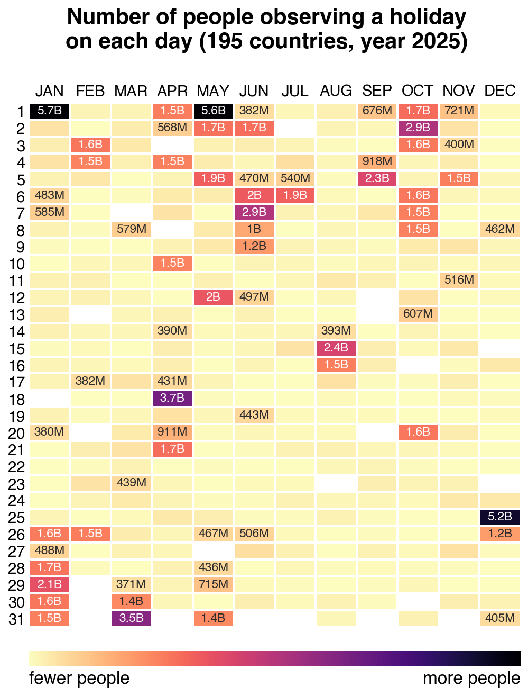
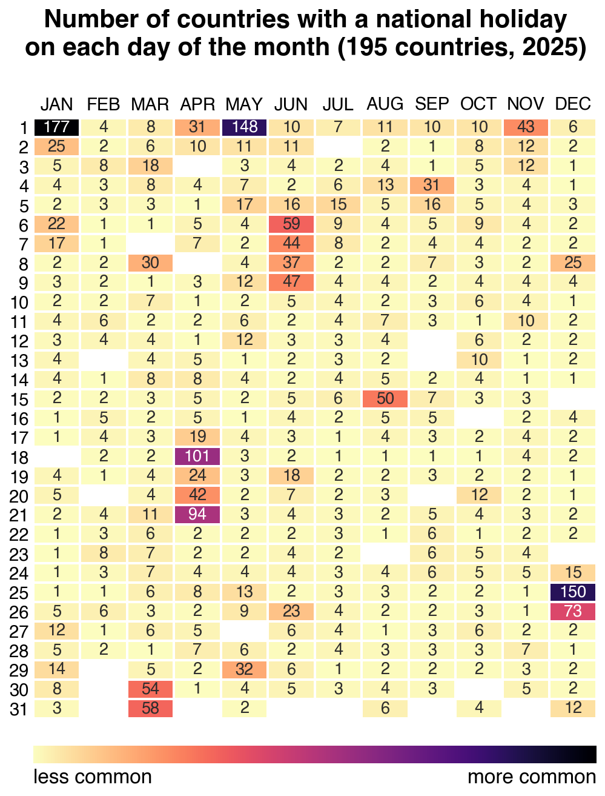

# National Holidays Heatmap (2025)

Two calendar heatmaps for 2025, built from national public holidays of **195 countries** (193 UN members + Holy See & Palestine).

## Population-weighted heatmap



Shows the **number of people observing a holiday** on each day, weighting each country's national holidays by its population.

## Country-count heatmap



Shows **how many countries** observe a national public holiday on each day.

## Run

```bash
pip install holidays pandas numpy seaborn matplotlib
python holidays_population_heatmap_2025.py
python holidays_heatmap_2025.py
```

Outputs `holidays_population_heatmap_2025.png` and `holidays_heatmap_2025.png`.

## Notes

- Data from [`python-holidays`](https://github.com/vacanza/holidays) v0.83 — national (non-regional) holidays only.
- Population from World Bank 2025 ([`population_2025.csv`](population_2025.csv)); Holy See (VA) filled manually, PS = Palestine.
- Days with no holiday are blank (white); the largest ~20% of cells are labelled in B/M/K.
- Ukraine contributes no holidays for 2025 (martial law), so 194 of the 195 countries actually appear in the data.
